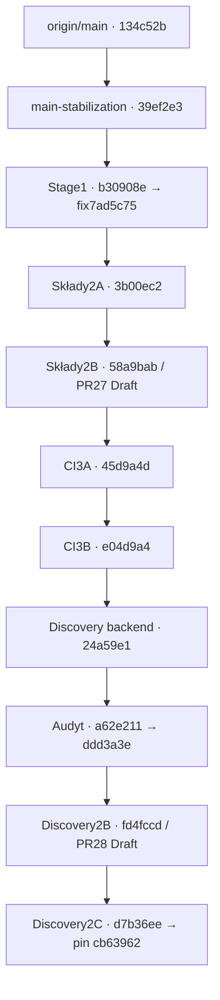

# Public Discovery — mapa integracji do Etapu2C

30.10.2026. Odczyt z Git i zdalnych refów, bez merge/rebase/retarget. Aktualny **origin/main=`134c52b1aee0d0804cc0cf71f151f95040e7a38f`**. Lokalny branch main nadal wskazuje starszy a46f5e4; nie przełączano go ani nie nadpisywano. W [JSON dowodowym](review/stage2c-evidence.json) sprawdzono każdą kolejną krawędź `merge-base --is-ancestor` poniższej historii.

| Kolejność logiczna | Gałąź/ref | Sprawdzony SHA |
|---|---|---|
| baza | origin/main | `134c52b1aee0d0804cc0cf71f151f95040e7a38f` |
| konsolidacja | chore/main-stabilization | `39ef2e3937b781439864029a92c12de315024263` |
| edytor Stage1 | feat/premium-lineup-editor-stage1 | `b30908e15cedff6ffa1a4ca76f0fb514e04302a7` |
| kontrakt Stage1 | fix/premium-lineup-stage1-contract | `7ad5c75414cf669d4471f3122e93073dab9aa8d7` |
| backend składów2A | feat/premium-lineups-stage2a | `3b00ec268a19f64516daebbf0b238d796e826cd1` |
| integracja składów2B | feat/premium-lineups-stage2b | `58a9babf257876e47cf6db269a0bf05d2e1db1f4` |
| CI3A | chore/slm-v1-integration-ready | `45d9a4dfba838ebf9ed70f73a1b2044352df8ecd` |
| CI3B | chore/slm-v1-integration-ci-stage3b | `e04d9a47560de36657da76f12ae63e20ef2299cb` |
| discovery backend | feat/public-match-discovery | `24a59e104bfe80b4d2f41cbd0ad02b58fc546040` |
| audyt discovery | audit/public-match-discovery-backend | `ddd3a3e2eaefdf449bc83c34c6335f42a2da4aab`, zawiera `a62e211c32e7a947abc6b1503186da0890f39c2c` |
| discovery2B | feat/public-match-discovery-stage2b | `fd4fccdc1c22caa5f217625809689f336139a122` |
| discovery2C: kodCI | chore/public-discovery-stage2c | `d7b36eee379acf5036f8ea8aaeeea5f7791c8a04` |
| discovery2C: osobny pointer | ta sama gałąź | `cb63962e0ff4ccfbc4fb7157e4627beeee5ae8d5`; późniejsze commity wyłącznie docs |

Audyt składów `audit/premium-lineups-stage2b/4443006` jest gałęzią przeglądową obok tego łańcucha, **nie przodkiem wymaganym przez discovery**. Android Studio workflow4503cb2 i lokalny backend9b06897 także są gałęziami obok. Nie trzeba ich scalać do discovery, aby zachować nowy kontrakt. Historyczne eksperymentalne Auth18/online i ich migracje nie są zależnością tej integracji. Wcześniejsze moduły już zawarte w main nie wymagają ponownego merge.

## Piny, które muszą przetrwać integrację

- Premium źródła: MAIN134c52b, APPROVEDa82397b, Stage1b30908e, backend składówb46b7b9, runtime składówf47cd80, discovery backend24a59e1 oraz runtimeUIae2fd95. `git show <SHA>:<plik>` nadal musi zwracać zatwierdzone treści. Manifest55 pozostaje bez zmian.
- Source gate CI: baza45d9a4d, implementacja Stage3B6d96391 oraz dokładny overlay discovery43f69a6. Nowa implementacjaCId7b36ee musi zachować ancestry tych źródeł i bazy; approvalcb63962 wskazuje d7b36ee. Osobny commit metadata nie może być utożsamiony z commitem kodu, do którego sam się odwołuje.
- Consolidation ma historyczny punkt odniesienia a46f5e4 oraz41 migracji z e04d9a4. Dokładnie jedna42 pochodzi z24a59e1. Żadna aktualizacja main nie upoważnia do automatycznego dopuszczenia43 lub eksperymentalnego Auth.
- Hosted validator nadal akceptuje PR do main z właściwymi rodzicami merge/SHA/repo albo dozwolony manual ref. Obecny Draft PR do Stage2B nie jest PR do main i nie należy fałszować jego kontekstu w celu uruchomienia joba.

## Bezpieczna kolejność po decyzji właściciela

1. Przejrzeć zależności w kolejności topologicznej tabeli: konsolidacja→Stage1→składy2A/2B→CI3A/3B→discovery→audyt→2B→2C. Potwierdzić dokładne piny i zakresy. Nie traktować stanu Draft lub lokalnych testów jako zgody na merge.
2. Zachować istniejące bazy PR: bieżący2C do `feat/public-match-discovery-stage2b`, PR28 do `audit/public-match-discovery-backend`, PR27 do składów2A. Nie retargetowano ich w tym zadaniu. Jeśli właściciel wybierze składanie PR zależnych do ich rodziców, robić to po review, od końca stosu ku rodzicom, używając merge zachowującego oryginalne commity. Następnie końcowy przegląd całego stosu względem aktualnego origin/main.
3. Integracja z main może odbyć się etapami w kolejności tabeli albo jednym przeglądniętym PR całego stosu. W obu wariantach zachować oryginalną historię przez zwykły merge; ostatni integrowany zakres ma obejmować źródła i osobny approval2C. Nie tworzyć wybranych cherry-picków lub squash całego stosu bez nowego projektu pinów. Po każdej zmianie bazy sprawdzić źródła/ancestry, diff i odpowiednie kontrole; nowy main z niezależnymi zmianami wymaga osobnego rozstrzygnięcia zgodności.
4. Przed finalnym merge do main: osobno autoryzowany hosted run po potwierdzeniu darmowego limitu i opt-in, jeśli właściciel go wymaga. Dotąd **GitHub-hosted NOT RUN**. Review root/workflow/secrets/ochron pozostaje osobnym uprawnieniem. Nie aktywować jobów tylko po to, by uzyskać zielony status Draft PR.

### Squash, rebase i usuwanie ancestry

Squash całego stosu usuwa wymaganych przodków z historii nowego main. Sam fakt, że stare obiekty da się pobrać z pozostałych gałęzi, nie spełnia `merge-base --is-ancestor`. Rebase lub cherry-pick commitów będących pinami tworzy nowe SHA; source guard może wtedy poprawnie odmówić mimo identycznych plików. Zwykły merge oryginalnej gałęzi zachowuje zarówno treści, jak i potrzebne ancestry.

Szczególnie nie squashować pary **d7b36ee→cb63962** do jednego zastępczego commita: stary implementation przestanie być przodkiem. Nie da się naprawić tego przez wpisanie SHA tego samego commita do własnej zawartości. Jeżeli zmiana historii zostanie osobno zatwierdzona, trzeba ponownie przejrzeć dokładne źródła/ancestry, zapisać nowy commit implementacji z dotychczasowym pointerem, a w kolejnym commicie przypiąć ten nowy SHA i powtórzyć source tests. Nie robić automatycznego rehash/re-pin. Przepisanie wyłącznie późniejszych dokumentów nie usuwa pinów, jeśli ich oryginalni przodkowie pozostają w historii.

**Ta mapa jest przygotowaniem integracji, nie instrukcją wykonania merge teraz.** Nie zmieniono main ani zdalnych baz. Aktualny raport: [Etap2C](PUBLIC_MATCH_DISCOVERY_STAGE2C.md); chronologia: `docs/ODPOWIEDZI_CODEX.txt`.
