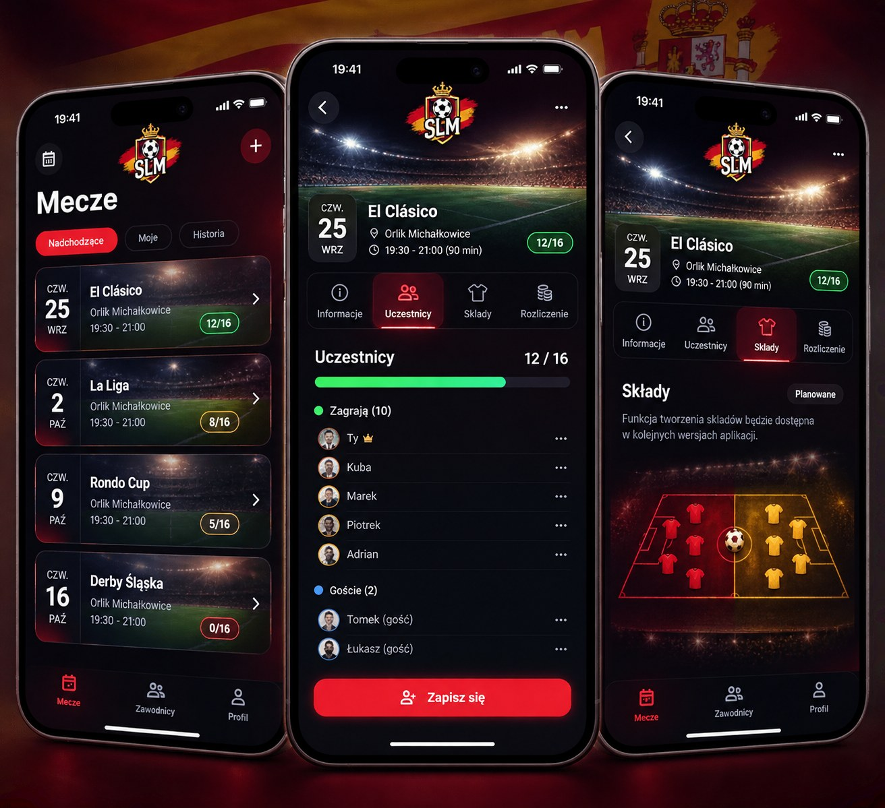
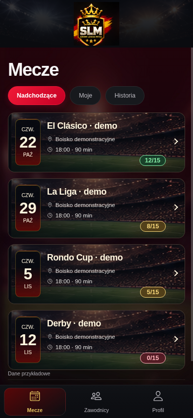

# Premium España 3.1 — Mecze / B. Urban Club

## Materiały obejrzane i kontrola zasobów

Obejrzano oba JPG Premium i premium-home-dark.png; główny wzorzec: lewy telefon
[slm-premium-three-phones.jpg](reference/slm-premium-three-phones.jpg).
Nowe zasoby pobrano fast-forward do301e7e3, bez nadpisywania lokalnych zmian.

| Zasób | Rozmiar | Bajty | Wykorzystanie |
|---|---|---|---|
| slm-logo-header.png |290×280|112288|nagłówek aplikacji i demo, oryginał bez zmian|
| slm-logo-primary.png |450×505|356938|zachowany; nie zastępuje małego logo nagłówka|
| stadium-bg-card.jpg |1400×800|130443|wspólne fotograficzne karty|
| stadium-bg-main.jpg |1400×800|140057|motyw nagłówka, większa fotografia szczegółów i fallback|
| espana-dark-texture.jpg |1080×1920|33168|subtelne tło wyłącznie Dark|
| slm-favicon-64.png |64×64|7713|favicon web i izolowanego demo|
| slm-app-icon-192.png |192×192|9590|manifest aplikacji, purpose any|
| slm-app-icon-512.png |512×512|53691|manifest aplikacji, purpose any|
| slm-app-icon.png |1024×1024|185183|zachowany, bez automatycznej modyfikacji Androida|
| slm-favicon-source.png |153×163|36759|zachowany oryginalny zasób źródłowy|

Wszystkie PNG są RGB, bez kanału alfa; logo ma własne czarne tło. Nie usuwano go,
nie deformowano proporcji i nie generowano pochodnych. Wyświetlane logo92px szerokości
zachowuje290:280, poniżej rozdzielczości źródłowej również przy3× DPR.
Zdjęcia są miękkie już w dostarczonych źródłach, ale wystarczające do kart na320–768px.
Nie stosowano sztucznego wyostrzania ani pobierania zdjęć. Nie potwierdzają Harcerskiej.
Stary SVG i wcześniejsze obrazy pozostają archiwalne, ale nie są używane w nowym UI
ani emitowane do demo. Brak maskowalnego wariantu/adaptacyjnych warstw Androida:
nie deklarujemy ikon natywnych jako ukończonych i nie uruchamiano cap sync.

## Układ i filtry

Demo: centralne oficjalne logo, tytuł Mecze, Nadchodzące/Moje/Historia, cztery
fotograficzne karty. Usunięto dominujący Następny mecz i CTA z listy; w szczegółach
pozostaje nieaktywny przykładowy przycisk. Nie ma atrap przycisków dzwonka/plus,
które w demo nie mają funkcji. W aplikacji dzwonek zachowuje prawdziwe centrum.
Nazwy zawodów wyłącznie fikcyjne w demo, oznaczone ·demo; realny model nie ma nazwy,
więc karta używa Mecz + dzień tygodnia. Godzina, lokalizacja i limit z backendu.

Demo: Nadchodzące4, Moje2 jawnie przypisane przykładowe mecze, Historia1 odrębny mecz
z października; wybór otwiera właściwą datę/licznik, powrót zachowuje filtr.
Realna aplikacja: Nadchodzące/Historia na aktualnej stronie events_list (50 rekordów),
porównanie starts_at z ostatnim server_now; odwołane też w Historii. Bez obietnicy
pełnego archiwum. Stronicowanie zachowane, Moje jawnie nieaktywne z opisem braku
informacji o zapisach w odpowiedzi listy. Nie pobieramy hurtowo szczegółów wszystkich
wydarzeń. Najbliższy mecz zachowuje istniejące CTA/RPC i nie jest powielany poniżej.
Ostrzeżenie o minimum po17 i decyzji administratora nadal widoczne w karcie.

## Iteracje rzeczywistego Chromium390×844

1. Nowe logo100px, filtry40px, karty128px. Tytuł y138, pierwsza karta y249;
   cztery karty kończyły się poniżej początku footera777. Zbyt wysoki nagłówek.
2. Logo92px, nagłówek96px, filtry38px, karty121px. Tytuł y121, filtry y174,
   pierwsza karta y227, czwarta kończy się około747. Wszystkie cztery widoczne.
   Light miał zbyt jasne tło za nieprzezroczystym logo; kadr zbyt przyziemny.
3. Ciemny brand header także w Light, zachowane ciepłe powierzchnie reszty ekranu.
   Sprawdzono kadr na światła; po obejrzeniu zdjęcia kadr38% pokazywał za dużo
   trybun i zbyt mało boiska. Finalnie70% jako kompromis; logo bez zmiany grafiki.
   Dodano zapas pod długimi metadanymi, żeby badge miejsc nie przykrywał tekstu.
   Po korekcie wykonano dodatkowy końcowy render całego smoke'a.

Obrazy cykli1/2: premium31-iteration1-home-dark.png i premium31-iteration2-home-dark.png.
Finalne pomiary DOM w premium31-measurements.json. To rzeczywiste screeny React/Ionic,
nie makiety, retusz ani test rzeczywistego Androida.

## Zestawienie referencji i finalnego UI

| Referencja — główny wzorzec lewy telefon | Rzeczywisty render390×844 |
|---|---|
|  |  |

[Light](premium31-home-light.png) · [320px](premium31-home-320.png) · [768px](premium31-home-768.png).

Usunięte różnice: stary herb SVG, dominacja godziny i CTA, brak tytułu Mecze/filtrów,
brak czwartej karty, fotografia zwykłego boiska zamiast stadionu, płaski licznik.
Nowe datowniki, badge12/15, 8/15 i0/15, różne kolory z tekstowym opisem dla czytnika,
zwarta typografia i bordowo-złoty klimat. Trzy pozycje dolnej nawigacji zachowane.

Pozostałe różnice: oficjalne logo B. Urban Club ma inny rysunek i własne prostokątne
tło niż znak na koncepcji; zachowano zatwierdzony plik. Inne teksty i daty, limit15
z danych (nie referencyjne16), font systemowy zamiast skondensowanego, brak obudowy
telefonu/statusbara, kadrowanie zależne od szerokości i miękkość dostarczonych JPEG.
Nie ma deklaracji identyczności pikselowej. Produkcja ma dodatkowe prawdziwe akcje,
CTA i opis ograniczeń filtrów; nie ukrywamy ich dla naśladowania konceptu.

## Wyniki końcowe

- TypeScript klienta i demo: OK (w obu buildach).
- ESLint: OK. Vitest:87/87,14 plików. Testy API są atrapami, nie prawdziwym Supabase.
- Build aplikacji i build demo: OK; pozostają ostrzeżenia chunków Ionic.
- Chromium: cykle1/2/3 + końcowa kontrola,320/390/768, brak overflow dokumentu,
  Enter/Spacja kart, Enter filtrów4/2/1, zakładki i powrót, Light/Dark/Auto/live system,
  suwak0/10/15 oraz obecność oryginalnego logo290px i stadionu1400px: OK.
- Demo14 statycznych plików: allowlista modułów (dodano wyłącznie MatchFilters),
  pięć jawnych zasobów branding porównanych bajtowo i sygnaturami PNG/JPEG,
  brak starego SVG, brak App/Auth/Supabase/Edge, bez żądań zewnętrznych i naruszeń CSP.
  CSP connect-src none z odpowiedzi lokalnego preview; Vercel config bez zmian.
- Cypress nie uruchamiano ponownie (znany brak Xvfb z3.0); dostosowano selektory.
- Android/iOS, PWA na urządzeniu i rzeczywisty backend: niewykonane.
- Brak migracji, cap sync, wdrożeń ręcznych, merge i zmian reguł biznesowych.

Na telefonie sprawdzić ostrość logo/ikon, safe areas, powiększenie fontu, powrót z tła,
filtry i stronicowanie prawdziwej listy oraz uprawnienia na izolowanym backendzie.
Automatyczny podgląd Vercel wymaga sprawdzenia na jego rzeczywistej domenie;
sam push nie jest dowodem udanego deploymentu.
