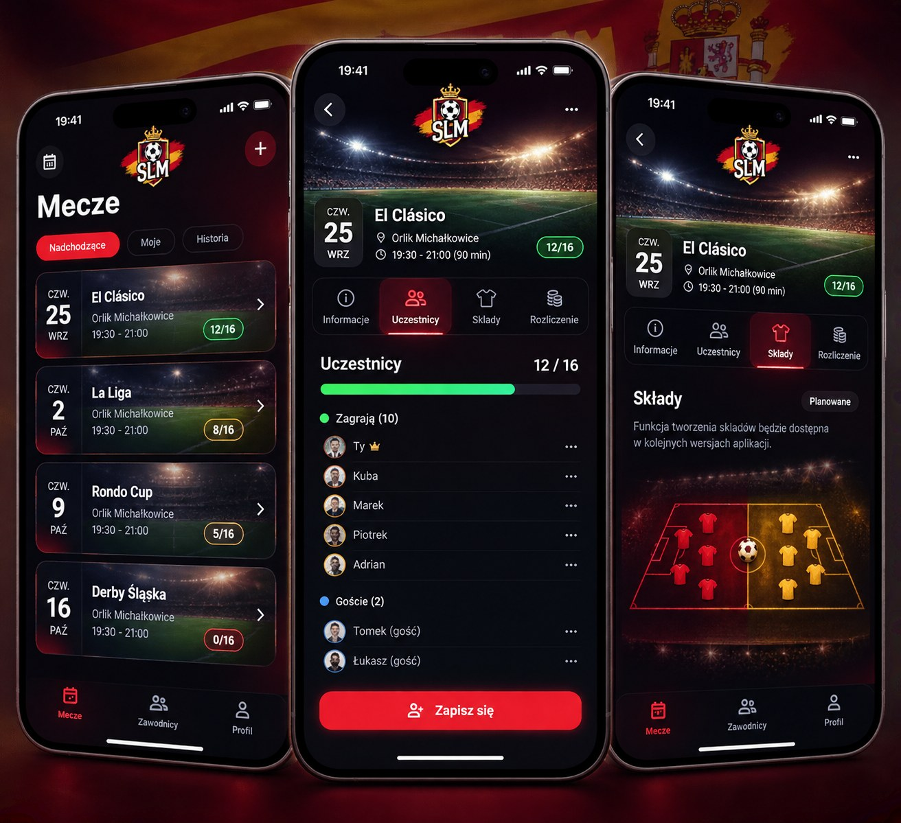
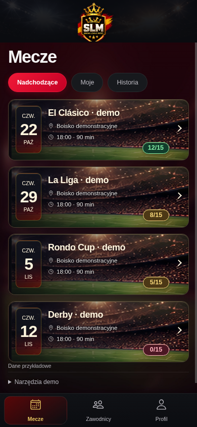

# Premium España3.2 — kanał alfa, nagłówek i światło

Obejrzano oba Premium JPG, premium31-home-dark/light.png oraz oryginalne header
290×280 i primary450×505. Zakres wyłącznie logo/CSS/emitowanie i kontrola zasobu.

## Oryginalna grafika bez przerysowania

Oryginały slm-logo-primary.png, slm-logo-header.png i slm-app-icon.png niezmienione.
Nowe: slm-logo-header-transparent.png290×280 i slm-logo-primary-transparent.png450×505,
PNG RGBA8 z prawdziwym alfa0–255. Bez mix-blend-mode i innych symulacji.
Automatyczny wariant edycji obrazu zmieniał drobny detal korony; odrzucono go,
nie skopiowano do repo i nie wykorzystano w UI. Bezpieczniejsza metoda:
maskowanie oryginalnych pikseli z ręcznie wyznaczonym chronionym wnętrzem tarczy,
kolorystycznym wyborem wyłącznie na zewnątrz i miękką alfą na krawędziach/smugach.
Nie stosowano globalnego usunięcia czerni. Po pierwszej kontroli maski poprawiono
obszar dolnej części header i usunięto zewnętrzną mgłę/część podpisu tła w primary.
Odrzuconych wersji z uszkodzonym konturem nie wdrożono.

Powtarzalny skrypt offline: create-logo-alpha.mjs (Node + ImageMagick7; nigdy
nie importowany przez aplikację). Maski odnoszą się wyłącznie do tych konkretnych
rozmiarów. Chronione RGB pozostają identyczne z oryginałem, alfa255 w całym rdzeniu;
skrypt sprawdza to piksel po pikselu. Przy zmianie źródeł wymagana ponowna ocena maski.
Zewnętrzne półprzezroczyste piksele mają usunięty czarny matte; czerwień i złoto
w smugach pozostają. Nie wygenerowano nowych elementów herbu.

Node scripts/verify-logo-alpha.mjs odczytuje i rozpakowuje rzeczywiste PNG, nie tylko
nazwę/rozszerzenie: RGBA8, narożniki przezroczyste, liczba pikseli alfa0/1–254/255.

| Plik | Alfa0 | Alfa1–254 | Alfa255 |
|---|---:|---:|---:|
| header |38113|3938|39149|
| primary |69438|2536|155276|

Dokładny audyt, wielokąty i SHA256 źródeł/pochodnych: premium32-alpha-audit.json.
Podglądy obu oryginalnych wycięć na tle jasnym/ciemnym to rzeczywisty render
lokalnego HTML w Chromium, nie kolejne wygenerowane herby:
[Light](premium32-logo-preview-light.png), [Dark](premium32-logo-preview-dark.png).

## Trzy iteracje rzeczywistego React/Ionic390×844

1. Przezroczysty header76px, sekcja78px, jasny header wraca w Light. Karty jaśniejsze,
   kontrast1.08/saturacja1.06, boczny cień zamiast ciemnej nakładki na całej fotografii,
   złoty rim i datownik z głębią. Render: tytuł y102, pierwsza karta y204, karta121px.
   Po obejrzeniu: herb mały; domyślne24px paddingu content zostawiało zbędną przerwę.
2. Herb82px bez deformacji; branding84px, padding listy10px zamiast24. Tytuł y94,
   filtry y144/h38, pierwsza karta y196/h121. Subtelniejsze obramowanie i większe cyfry
   datownika. Obie wersje obejrzane; potrzeba jeszcze światła i kontrastu badge na murawie.
3. Kadr60%, delikatny refleks u góry, miękki cień metadanych, ciemne nieprzezroczyste
   tła badge w Dark. Pozostałe wymiary jak2. Ponowny render/ocena Dark i Light,
   kontrola320/390/768 i podgląd logo na obu tłach. Cztery pełne karty z większym
   zapasem przed footerem777; układ nie wymaga nowej listy ani zmiany danych.

Zachowano [cykl1](premium32-iteration1-home-dark.png),
[cykl2](premium32-iteration2-home-dark.png) i pomiary premium32-measurements.json.
[Final Dark](premium32-home-dark.png), [Final Light](premium32-home-light.png),
[zbliżenie nagłówka](premium32-header-detail.png), [320](premium32-home-320.png),
[768](premium32-home-768.png). Header-detail to kadr Chromium ze skalą2, nie retusz.

## Referencja i wynik

| Główny wzorzec: lewy telefon | Działające UI |
|---|---|
|  |  |

Usunięto czarny kwadrat, zmniejszono branding96→84px, pierwsza karta227→196px.
Źródłowa fotografia widoczna jaśniej, mocniejszy stadionowy refleks, głębia datowników,
subtelny złoty rant, badge kontrastuje z murawą. Nie zmieniano proporcji121px kart.

Pozostałe różnice: systemowy font, inne teksty/daty i limit15 z danych, miękkość JPEG
oraz rysunek zatwierdzonego B. Urban Club inny niż koncept. Oryginalny header ma
ucięcie dolnego końca znaku na granicy rastra, a primary i header mają różne kompozycje;
nie domalowywano końca tarczy ani nie ujednolicano ich przez generowanie nowego logo.
Zachowano kolorową poświatę należącą do smug; nie usuwano jej kosztem detali.
Nie jest to deklaracja zgodności pikselowej ani pełnego audytu dostępności.

## Weryfikacja i granice

ESLint/TypeScript klienta i demo/oba buildy OK, Vitest87/87 (14 plików).
Trzy przebiegi Chromium320/390/768: brak poziomego przewijania, karty/filtry klawiaturą,
zakładki i powrót, motywy/live system i suwak0/10/15 OK. Demo14 plików, allowlista
bez rozszerzania o aplikację, emitowane tylko zatwierdzone zasoby; header zamieniony
na transparent, dokładna zgodność bajtów plus kontrola alfa w build verifier.
CSP i brak żądań zewnętrznych/backendu OK. PublicDir/env/Vercel bez zmian.
Safe areas dziedziczone z IonHeader/IonToolbar i istniejącej nawigacji; nie zerowano
insetów i nie ustawiano sztywnej wysokości całego headera. Android/iOS niewykonane.
Cypress nie ponawiano (znany brak Xvfb). Testy na atrapach nie weryfikują Supabase.
Bez backendu/Auth/RPC/RLS/migracji/finansów/push/Firebase, reguł zapisów, danych,
konfiguracji produkcyjnej, merge i ręcznego deploy. Pozostało ostrzeżenie chunków.
