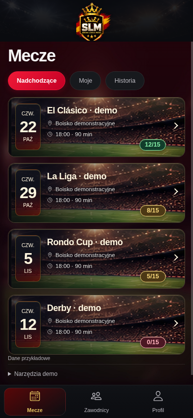
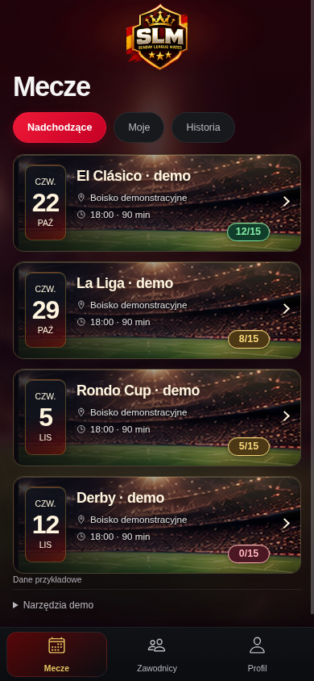

# Premium España3.3 — Floating Crest

## Zakres i materiały

Obejrzano oba obrazy referencyjne Premium, premium32-home-dark/light.png oraz
istniejący slm-logo-primary-transparent.png. Nie projektowano nowego logo.
PNG450×505 RGBA pozostaje bajtowo niezmieniony. Obszar niezerowego alfa:
(0,9)–(449,496), około9px nad/pod znakiem; smugi dochodzą do boków.
Nie ma dużych zbędnych marginesów, więc nie przygotowano nowej/przyciętej kopii.
Wersja primary ma pełną dolną część tarczy, koronę wewnątrz znaku, SLM i3 gwiazdki;
nie dorabiano zewnętrznej korony z odmiennej wersji header ani z konceptu.

## Rozwiązanie warstw i przewijania

Branding przeniesiono z oddzielnego IonHeader/IonToolbar do początku main wewnątrz
IonContent. Na tych ekranach nie ma paska nawigacyjnego wymagającego toolbaru;
przycisk powiadomień aplikacji pozostał z identycznym warunkiem i callbackiem.
IonPage/IonContent/IonFooter oraz cała nawigacja pozostają. Logo przewija się
w normalnym układzie; nie jest fixed/sticky i nie nakłada się na treść.

.slm-floating-brand ma izolowany stacking context (0), dekoracja jest lokalną
warstwą0 bez pointer-events, obraz relative/z2, istniejący przycisk z3. Brak
arbitralnie wysokich z-index. Brak osobnej fotografii/tła toolbaru, linii i prostokąta:
przezroczysty wrapper nad istniejącym tłem IonContent zapewnia ciągłość Dark/Light.
Za herbem tylko lokalne, miękkie radialne bordo/gold. Obraz contain/height:auto,
450:505, bez overflow:hidden i bez nowego kadrowania. Szerokość clamp76px/19.5vw/84px.

Usunięcie toolbaru oznacza, że górny safe area jest teraz jawnie doliczany do
paddingu brandingu: --ion-safe-area-top z fallbackiem env(safe-area-inset-top).
Nie zerowano insetów. Powiadomienia mają analogiczny offset. Dolny safe area jest
nadal obsługiwany przez istniejący footer. Rzeczywistego Androida/iOS nie testowano.

## Trzy iteracje Chromium

1. Podmiana na pełny primary i przeniesienie do treści, jedna tekstura strony.
   Logo78×87.5 przy390px, tytuł y93.5, pierwsza karta195.4. Nie ma już oddzielnego
   pasa; cała tarcza widoczna w Dark/Light. Po ocenie: halo można stonować,
   marginesy dają jeszcze kilka pikseli do odzyskania.
2. Halo mniej intensywne; logo76.05×85.33, padding3px+safe area i1px pod znakiem.
   Tytuł y89.3, filtry139.2, pierwsza karta191.2. Cztery karty nadal widoczne.
   Po ocenie: ograniczyć zasięg dekoracji pod tytułem i dopilnować wyższego priorytetu
   selektora dla istniejącego przycisku powiadomień względem starszych reguł headera.
3. Lokalniejsze gradienty; stacking0/2/3 oraz jawny selektor pozycjonowania kontrolki.
   Ponowny render i ocena390 Dark/Light oraz320/768. Wymiary jak2, płynne tło,
   cały herb, bez wpływu na karty/filtry/footer. Test przewijania potwierdza, że
   znak znika z viewportu przy scrollowaniu, a nie zostaje przyklejony.

[Cykl1](premium33-iteration1-home-dark.png), [cykl2](premium33-iteration2-home-dark.png).
Finalne pomiary DOM: premium33-measurements.json.

| Element390×844 | Beta3.2 | Beta3.3 |
|---|---:|---:|
| Obraz | header290×280, ucięty dół źródła | primary450×505, pełny znak |
| Render obrazu |82×79.17|76.05×85.33|
| Tytuł y |94|89.33|
| Pierwsza karta y |195.84|191.17|
| Karta wysokość |121|121|
| Filtry wysokość |38|38|
| Footer y / wysokość |777 /67|777 /67|
| Pełne karty widoczne |4|4|

Zysk miejsca na390px to tylko około4.7px, nie dodatkowa karta. Najważniejszy efekt
to kompletność herbu i brak oddzielonego paska. Przy768 logo skaluje się do84px,
co zajmuje kilka pikseli więcej niż3.2; nadal widać4 karty. Nie zmieniano ich liczby.

## Porównanie

| Premium3.2 | Premium3.3 |
|---|---|
|  |  |

[Light](premium33-home-light.png) · [320px](premium33-home-320.png) · [768px](premium33-home-768.png).
To rzeczywiste rendery React/Ionic z Chromium, bez makiet/retuszu.

## Wyniki i granice

ESLint, TypeScript obu wejść, build aplikacji i build demo OK. Vitest87/87,
14 plików. Trzy pełne przebiegi Chromium320/390/768: brak overflow dokumentu,
contain/ratio pełnego obrazu, relative zamiast fixed, scroll, top safe area32px
(symulacja CSS), klawiatura kart/filtrów/zakładek, jeden panel, powrót, dolna
nawigacja Mecze/Zawodnicy/Profil, Light/Dark/Auto/live system i suwak0/10/15 OK.

Demo14 plików: zamieniono wyłącznie emitowany header na primary. PNG pozostaje
zgodny bajtowo, alpha i sygnatura są weryfikowane; tylko dla tego zatwierdzonego
pliku315574B limit350KB zamiast160KB. Pozostałe limity, allowlista modułów,
publicDir false, env i CSP bez zmian. Brak API/Auth/Supabase/Edge/żądań zewnętrznych.
app/vercel.json i konfiguracja produkcyjna bez zmian. Nie uruchamiano deploymentu.
Duże chunki Ionic pozostają. Cypress nie ponawiano (znany brak Xvfb).
Android/iOS i rzeczywisty backend niewykonane. Symulacja safe area nie jest testem
paska systemowego urządzenia; należy sprawdzić notch/statusbar i powrót z tła.
Testy API używają atrap, nie prawdziwego Supabase.

Karty, filtry, dolna nawigacja, dane i komponenty szczegółów/zakładek bez przebudowy.
Nie zmieniono backendu, Auth, RPC/RLS/migracji, zapisów/gości/rezerwy, finansów,
Firebase/push. W Accounts zmieniono wyłącznie strukturę brandingu i importy UI.
Pozostały różnice konceptu: rysunek oficjalnego herbu, systemowy font i źródłowe
zdjęcie/kadr. Nie deklarujemy zgodności pikselowej ani gotowości produkcyjnej.
