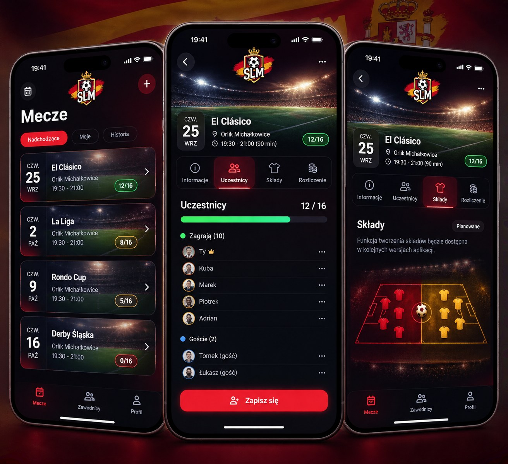
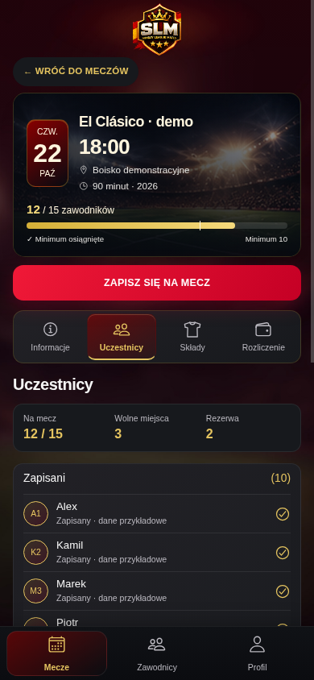

# Premium España3.4 — szczegóły i uczestnicy

## Zakres i wzorzec

Obejrzano premium33-home-dark/light oraz obie referencje Premium: środkowy telefon
z listą osób i prawy z planowanymi składami. Premium3.3 pozostaje zatwierdzonym home.
Końcowe rendery home są bajtowo identyczne ze zrzutami3.3 (Dark i Light), nie tylko
zbliżone kolorem. SHA256 i wynik: premium34-home-regression.json.
Nie zmieniano kart listy, filtrów, dolnej nawigacji ani fixture meczów.

## Co działa w aplikacji

- Wspólna karta szczegółów z istniejącym stadium-bg-main.jpg, datownikiem, godziną,
  lokalizacją, czasem, rokiem i dostępnym paskiem zajętości/minimum10. Nazwa demo
  pochodzi z wybranego fixture; model realnego meczu nie ma nazwy, więc pozostaje
  Mecz + dzień tygodnia. Brak fikcyjnego El Clásico w produkcji.
- Powrót zachowuje istniejący callback/list(), ma nową etykietę i kompaktowy wygląd.
  Admin nadal ma edycję/odwołanie i dotychczasowe kontrolki. Główne akcje mają busy,
  disabled i istniejący komunikat sukcesu/błędu. Zestaw RPC/argumentów bez zmian.
- Nowy ParticipantGroup/RosterSummary współdzielony przez demo i aplikację:
  zajęte/wolne/rezerwa, liczniki grup, inicjały, jawne statusy zapisany/nieobecny/
  na rezerwie i osobne grupy Zapisani/Goście/Rezerwa. Gość jest nadal uczestnikiem
  z member_id=null i istniejącym odpowiedzialnym, nie nowym kontem.
- Po5 zapisanych: Pokaż wszystkich/Zwiń, aria-expanded/aria-controls. Stan rozwinięcia
  pozostaje po przełączeniu zakładek; panele nadal zamontowane, widoczny tylko jeden.
  Brak danych daje stan pusty. Kontakt pojawia się tylko gdy backend podał numer.
  Istniejące uprawnienia/operacje w wierszach i formularz gościa pozostały.
- Cztery poziome zakładki z ikonami, default Uczestnicy, aria-orientation horizontal,
  roving tabindex/strzałki/Home/End, lokalny scroll na320px. Czerwono-złoty aktywny stan.
- Synchroniczny ref w istniejącym work() blokuje powtórne uruchomienie akcji w tym UI
  do zakończenia promise, zanim asynchroniczny disabled się odświeży. finally zwalnia
  blokadę także po błędzie. To lokalna osłona interfejsu, nie zastępnik atomowości serwera.
  Backend/RPC/finanse/UUID gości i role bez zmian.

## Co pozostaje demonstracyjne

Demo nie zapisuje uczestników, gości, rezerwy ani wpłat. Przycisk zapisu jest nadal
nieaktywny; fikcyjne osoby i wydarzenia są oznaczone jako demo. Rozliczenie:
Funkcja w przygotowaniu i brak należności/sald. W aplikacji prawdziwy panel finansów
admina/komunikat gracza pozostał bez zmiany; nie zastąpiono dostępnych danych atrapą.
Składy: Planowane, dekoracyjne koszulki/boisko bez przypisań i algorytmu.
Informacje demo mają czytelne pola bez fikcyjnych kwot. Light/Dark/Auto bez zmian.

## Trzy cykle rzeczywistego Chromium390×844

1. Fotograficzna karta i nazwa, krótszy CTA44px i zakładki58px, wspólne grupy i statusy.
   Obejrzano uczestników Dark, Składy Dark i Informacje Light. Nadal zbyt wysoko
   zaczynała się lista, a licznik12/15 był zdublowany nad nowym podsumowaniem.
2. Usunięto duplikat licznika, skrócono dekoracyjny obszar karty38→24px i herb
   wyłącznie w szczegółach do60px (home bez zmian). Informacje jako opisane pola,
   nie luźny blok akapitów. Po renderze lista pokazuje więcej osób, boisko mieści
   się w pierwszym ekranie. Do poprawy drobny tekst statusów i cel dotykowy rozwijania.
3. Statusy mają większą czytelną interlinię, łamanie długich nazw, spójne separatory;
   rozwijanie44px, focus wewnątrz zakładek i właściwy aria-controls. Ponownie obejrzano
   Dark/Light uczestników i Składy. Dodatkowy końcowy przebieg zapisał także przewinięty
   widok wszystkich grup, sprawdzono obrót844×390 i brak utraty aktywnej zakładki.

[Cykl1](premium34-iteration1-participants-dark.png), [cykl2](premium34-iteration2-participants-dark.png).

## Rzeczywiste zrzuty

- [Informacje Dark](premium34-details-dark.png), [Informacje Light](premium34-details-light.png)
- [Uczestnicy Dark](premium34-participants-dark.png), [Uczestnicy Light](premium34-participants-light.png)
- [Zapisani/Goście/Rezerwa po przewinięciu](premium34-participants-groups-dark.png)
- [Składy Dark](premium34-teams-dark.png)

| Wzorzec środkowego/prawego telefonu | Render |
|---|---|
|  |  |

To screeny React/Ionic, nie makiety, retusz ani test Androida.

## Weryfikacja

ESLint, TypeScript klienta i demo, build aplikacji i demo OK (ostrzeżenia dużych
chunków Ionic). Vitest90/90 w14 plikach: dotychczasowe join/reserve/withdraw/blokada/
zamknięcie oraz nowe: duplikat podczas pending, zakończenie/busy, gość tylko raz,
rezerwa poza zajętością, brak kontaktów gdy serwer nie podał, brak cudzych kontrolek,
rozwinięcie/zwinięcie i zachowanie stanu między panelami. To atrapy API, nie Supabase.
Pierwsze przebiegi wymagały dostosowania asercji do5-wierszowego podglądu oraz
asynchronicznych właściwości Ionic i istniejącego prefiksu✓ komunikatu sukcesu;
po poprawkach wykonano cały zestaw. Nie wyłączano ani nie pomijano testów.

Chromium320/390/768: brak poziomego overflow, taby po jednym, klawiatura kart/filtrów/
zakładek, rozwijanie, obrót844×390, powrót, dolna nawigacja, motywy/live system,
suwak i safe area/scroll z3.3 OK. Home Dark/Light identyczne z3.3 bajtowo.
Demo14 plików: jedyny nowy dozwolony moduł ParticipantGroup (tylko UI); allowlista,
kontrola artefaktów/alfa/oryginalnego logo i CSP zachowane. Brak żądań zewnętrznych,
App/Auth/Supabase/Edge/sekretów/danych rzeczywistych. Konfiguracja Vercel bez zmian.
Cypress nie uruchamiano — brak Xvfb. Android/iOS i realny backend niewykonane.

## Pozostałe różnice

Systemowa typografia, inne zdjęcie/kadr i oficjalny herb z3.3; inicjały zamiast
portretów, brak kontaktowych menu⋯ bez funkcji. W produkcji uprawnione operacje,
telefony i formularze wymagają większej wysokości niż koncepcyjne wiersze.
Pięć osób to podgląd rozwijany, a goście/rezerwa wymagają przewinięcia na390×844.
Bez deklaracji zgodności pikselowej ani gotowości produkcyjnej. Na urządzeniu
sprawdzić notch/statusbar, skalowanie tekstu i klawiaturę formularzy, wznowienie,
realne role i współbieżność na izolowanej bazie. Nie uruchamiano migracji ani deploy.
