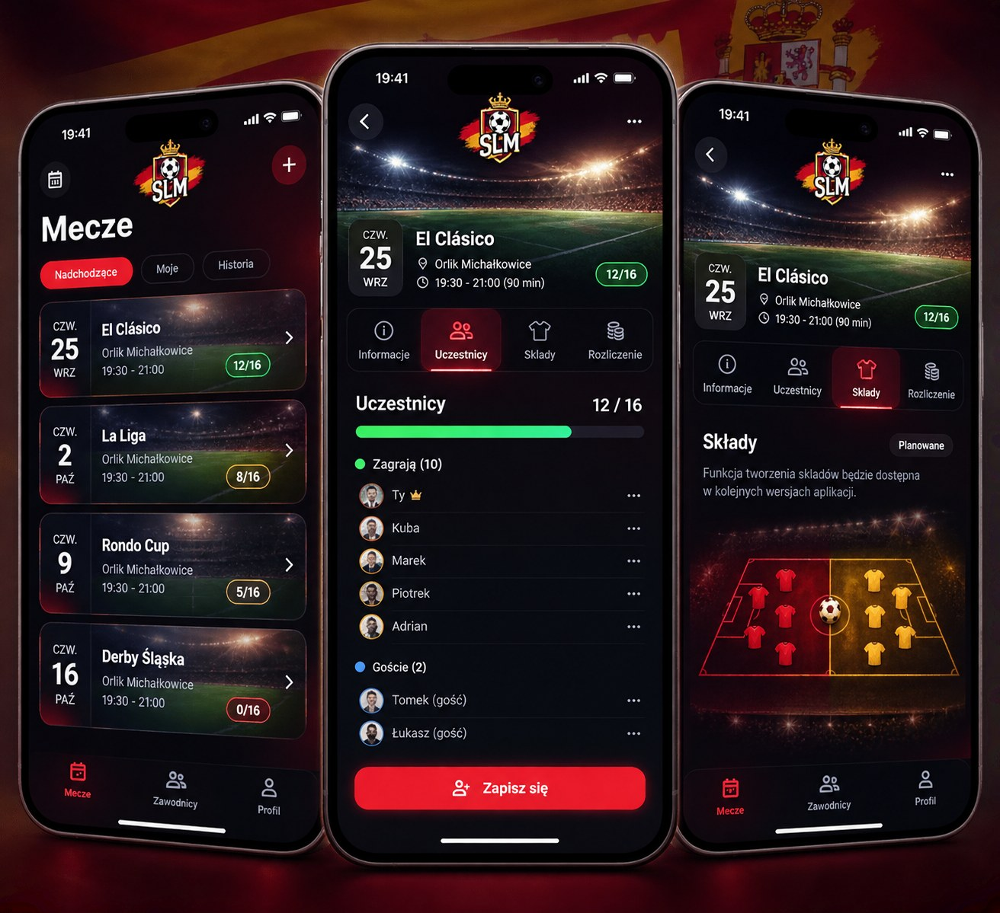
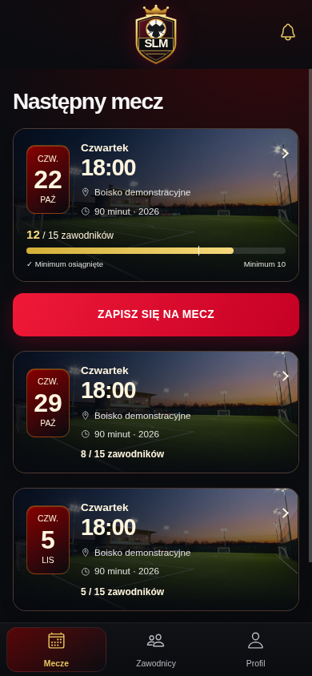
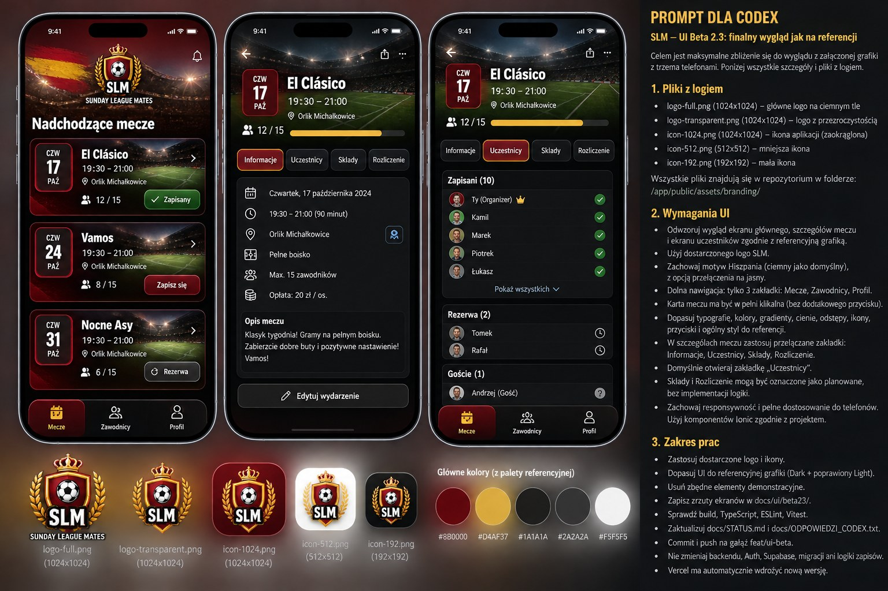
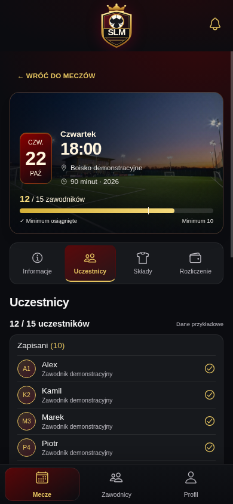

# Premium España — specyfikacja wizualna 3.0

## Materiały obejrzane przed implementacją

Oba nowe JPG dostarczono w 2f2d8a2; rzeczywiście otwarto je oraz zrzuty Beta 2.3.
- [Trzy telefony](reference/slm-premium-three-phones.jpg)
- [Tablica projektu](reference/slm-premium-ui-branding-board.jpg)
- Poprzednie home/details: beta23-home-dark.png i beta23-details-dark.png.

Nowe grafiki mają pierwszeństwo. To wizualizacje, nie projekty z mierzalną siatką:
proporcje poniżej są przybliżeniem obszarów ekranów, bez obudowy telefonu.
Grafiki różnią się między sobą: zielone versus złote paski, herb bez/z wieńcem,
różne położenie datownika i nagłówka. Wspólny układ: fotograficzna karta,
datownik po lewej, stadion w szczegółach, cztery zakładki, dolne trzy zakładki.
Wybieramy złoty pasek z board, centralny istniejący herb i zwarty układ listy.

## Analiza różnic i plan przed CSS

| Element | Beta 2.3 | Premium / kierunek wdrożenia |
|---|---|---|
| Herb | mały54x61, lewy róg | centralny, około74–88px wysokości; dzwonek po prawej |
| Karty | jedna płaska powierzchnia200px, osobny obraz144x104 | zdjęcie pełnej szerokości w tle, gradient pod tekstem; zwarte~150px |
| Data | drobny wiersz pod wielką godziną | pionowy datownik około55x88; dzień liczbowy30–34px |
| Hierarchia | godzina43px | nazwa/lokalizacja i czas20–24px; nie wymyślać tytułów w prawdziwych rekordach |
| Zdjęcie | osobne zaokrąglone okienko | wtopione boisko z cieniem; użyć wyłącznie istniejącej fotografii |
| Pasek | pełna szerokość na dole, gold | cienki8–10px, złoto, opis minimum dostępny |
| Szczegóły | druga karta identyczna z home, dużo pustego panelu | większa fotografia~185px i metadane na dole; zwarty pasek zakładek |
| Zakładki | pojedyncza złota kreska | niski panel, aktywny burgund, złoty/czerwony akcent i ikona |
| Uczestnicy | licznik w pustym panelu demo | awatary/inicjały, nazwy, jawne statusy; oddzielne grupy i rezerwa |
| Składy | tekst planowane | dekoracyjne boisko z dwoma kolorami koszulek, bez algorytmu i przypisania osób |
| Nawigacja | grafitowy płaski pas | prawie czarne szkło, cienka krawędź i burgund aktywnej pozycji |
| Tło | płaski grafit z poświatą | niemal czarne tło, bordowe światło u góry, złote refleksy, bez ciężkich animacji |

## Granice i decyzje

Istniejący SVG zachować bez zmian; nie wycinać herbów ani stadionu z JPG projektu.
Zdjęcie match-evening.jpg nie jest potwierdzonym zdjęciem Harcerskiej i nie ma trybun
z referencji. Nie pobierać obcych zdjęć. Nie dodawać nowych fontów z sieci.
Auto/Light/Dark i powiększanie tekstu zachować. Light ten sam układ i ciepłe białe
powierzchnie; ciemny gradient tylko pod białym tekstem na fotografii.
Prawdziwa aplikacja korzysta z dotychczasowej listy/RPC, bez fikcyjnych tytułów.
Demo może zawierać jawnie fikcyjne spotkania i inicjały zamiast prawdziwych portretów.
Listy produkcyjne zachowują kontakty i operacje zależne od uprawnień.
Składy: wyłącznie dekoracja i status Planowane; rozliczenie demo niedostępne.
CSP i allowlista demo bez poluzowania; ewentualne nowe moduły wyłącznie UI.

## Iteracje i wyniki

Uzupełniane po rzeczywistych renderach Chromium390x844. Nie deklarować pełnej
zgodności ani trzech cykli przed ich wykonaniem.

### Cykl 1 — wykonany render Chromium 390×844

Centralny herb74×82; tytuł y122, karta y172/h192, CTA y378, footer y777.
Zdjęcie pokrywa całą kartę; datownik54×86. Wprowadzono oddzielne grupy demo,
planowane boisko, niższe karty i burgund aktywnej zakładki.
Obejrzano home/participants/teams. Różnica: szczegóły nadal za wysokie, uczestnicy
dopiero poniżej600px, a dekoracja składów poza pierwszym ekranem.
[Home](premium-iteration1-home-dark.png), [Składy](premium-iteration1-teams-dark.png).

### Cykl 2 — korekta, kolejny build i render

Herb68×76, tytuł y110, karta y160, CTA y366. Ukryto wizualnie redundantny tytuł
szczegółów (nadal h1 dla technologii asystujących); skrócono back i obszar zdjęcia.
Uczestnicy zaczynają się około499px zamiast615px. Lista44px/wiersz zamiast49px.
Kadrowanie przesunięto w stronę boiska. Obraz o innym formacie i zachodzie słońca
nadal różni się od stadionu z trybunami; CSS nie odtworzy nieobecnej fotografii.
Po obejrzeniu: tekst planowania zbyt długi, boisko nadal za nisko; potrzebna korekta.
[Home](premium-iteration2-home-dark.png), [Składy](premium-iteration2-teams-dark.png).

### Cykl 3 — końcowa korekta i ponowne obejrzenie

Skrócono komunikat o planowanych składach, wyregulowano padding boiska i tekst;
dwa zestawy po5 koszulek mają charakter dekoracyjny, bez nazw/algorytmu.
Boisko widoczne w pierwszym ekranie; dalszy opis i listy są przewijalne.
Właściwa lista wydarzeń używa tej samej klikalnej karty, istniejących danych i open().
W produkcji oddzielono wizualnie gości od zawodników, nie zmieniając ich statusów,
kontaktu ani operacji. Demo ma3 jawnie przykładowe daty; wybór daje zgodne szczegóły.
Obejrzano home Dark, uczestników Dark, składy Dark i informacje Light.
Pomiary home jak w cyklu2; finalne pomiary: premium-measurements.json.

## Zestawienie referencja / działający render

| Wzorzec | Render React/Ionic |
|---|---|
|  |  |
|  |  |

Dalsze zrzuty: [Home Light](premium-home-light.png),
[Informacje Dark](premium-details-dark.png), [Informacje Light](premium-details-light.png),
[Składy Dark](premium-teams-dark.png). To rzeczywiste screenshoty390×844,
bez malowania UI w edytorze. Nie są testem urządzenia Android.

## Pozostałe różnice

Zdjęcie z repo przedstawia inne boisko i zachód, bez tłumu/trybun. Herb SVG jest
prostszy niż na branding-board; oryginału nie zastąpiono grafiką wyciętą z JPG.
Typografia systemowa różni się od bardziej skondensowanej w obrazie koncepcyjnym.
Prawdziwe wydarzenia nie mają pola nazwy zawodów, więc nie dodano fikcyjnego
El Clásico do aplikacji. Główne demo zachowuje tytuł Następny mecz i CTA osobno;
niżej dwa przykładowe mecze. Nie dodano fikcyjnych filtrów Nadchodzące/Moje/Historia.
Inicjały zamiast fotografii ludzi, dłuższe dostępne opisy statusów i minimum10;
zespoły bez przypisań i realistycznej perspektywy. Nie deklarujemy pełnej zgodności.

## Weryfikacja

ESLint i TypeScript klienta/demo, build aplikacji oraz demo OK (ostrzeżenie chunków).
Vitest85/85 w14 plikach. Trzy przebiegi Chromium:320/390/768, zakładki w jednej linii,
bez poziomego przepełnienia dokumentu, Enter/Spacja/Home/End/strzałki, powrót,
Light/Dark/Auto/live system, suwak0/10/15, jeden widoczny panel i izolacja/CSP OK.
Testy RPC używają atrap i nie weryfikują prawdziwego Supabase. Demo12 plików,
kontrola modułów i zgodności bajtów oryginalnego herbu OK. Brak zewnętrznych żądań.
Cypress próbowano: niewykonany, spawn Xvfb ENOENT. Android/iOS niewykonane.
Nie uruchamiano cap sync, bazy, migracji, merge ani ręcznego deploymentu.
